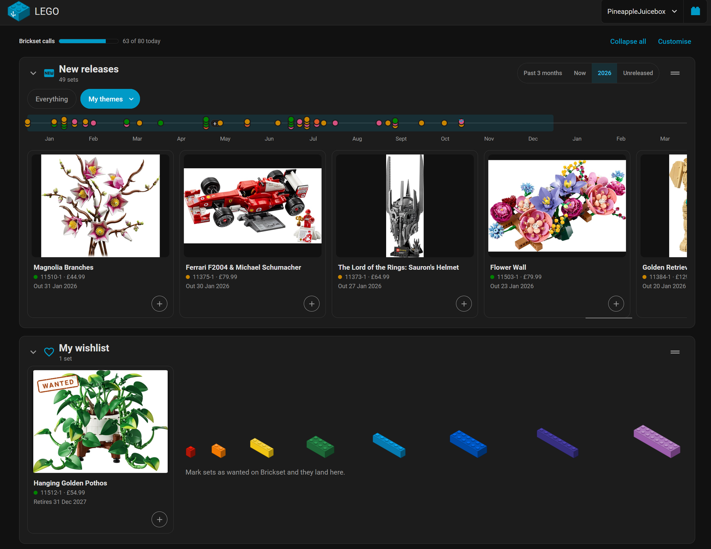
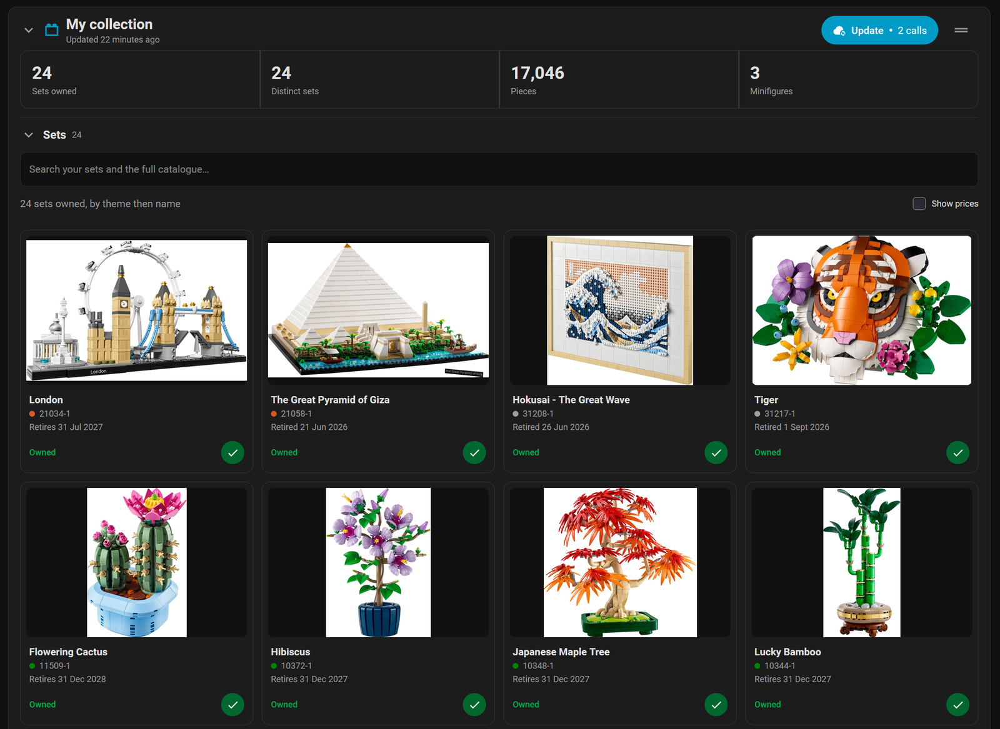
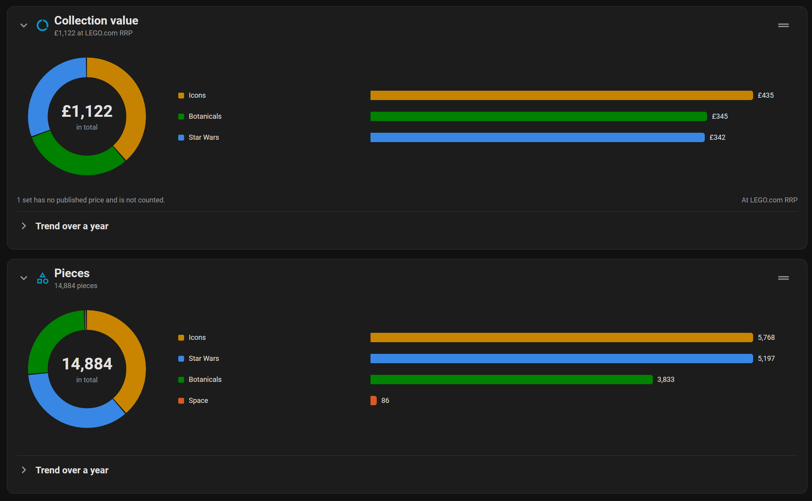

<p>
<a href="https://github.com/PineappleEmperor/ha-lego/releases"></a>
<a href="https://github.com/PineappleEmperor/ha-lego/commits/main/"></a>

<a href="https://github.com/hacs/integration"></a>
<a href="LICENSE"></a>
<br>


<a href="https://buymeacoffee.com/PineappleEmperor"></a>
</p>

# LEGO for Home Assistant

Keep up with LEGO from Home Assistant. Your [Brickset](https://brickset.com) wishlist
warns you before a set leaves sale, new sets show up the day Brickset lists them in the
themes you follow, and releases and retirements land on Home Assistant's calendar. Your
collection's totals and its value at LEGO.com prices come with it, and a sidebar panel
and dashboard cards show the lot.

> [!IMPORTANT]
> This project is **not affiliated with, authorised by, or endorsed by the LEGO Group**.
> LEGO® is a trademark of the LEGO Group. Set data, prices and images come from
> [Brickset.com](https://brickset.com) via their public API, and every set links back to
> its Brickset page. The local set index, and the pictures of the few sets Brickset has
> none of, come from [Rebrickable](https://rebrickable.com/downloads/). Neither Brickset nor Rebrickable is
> affiliated with this project or involved in it. No affiliate or referral links are used
> anywhere in this integration.

## What you can do with it

- Get a reminder before a set on your wishlist leaves sale, or when its price changes.
- Hear about a new set the day Brickset lists it in a theme you follow, and add it to
  your wishlist from the panel or an automation.
- See releases, retirements and the birthdays of your own sets on Home Assistant's
  calendar.
- Mark a set owned or wanted from the panel, an automation or a script, without opening
  Brickset.
- Keep an eye on the collection itself: sets, pieces and minifigures, and what it all
  cost at LEGO.com prices.

## Where the data comes from

Everything about your collection comes from [Brickset](https://brickset.com): the sets
you own and want, every set's details, pictures, release and retirement dates, and
LEGO.com prices. Brickset is also where your changes go, so marking a set owned here
marks it owned on your Brickset account.

Set pictures are plain image files on Brickset's site and cost no API calls. Home
Assistant downloads each one the first time a card shows it and keeps it in its cache
folder, which backups leave out, so a dashboard on a network without internet still
draws every set it has shown before. For a set Brickset has no picture of, mostly
promotional ones, Home Assistant keeps Rebrickable's picture instead, and a set neither
has a picture of shows the integration's icon. A picture not yet kept is fetched from
Brickset directly.

Brickset allows each API key 100 requests for set data a day, the integration's own
polls included, which searching from a dashboard would soon use up. So the integration also keeps a local list of every LEGO set from
[Rebrickable](https://rebrickable.com/downloads/), which updates it about daily; the
integration checks for a new copy once a month by default, and Brickset's own polls
bring the sets announced in between. Searching the panel reads that list
and costs nothing. Marking a set owned or wanted costs nothing either once the
integration has seen the set; a set it has never seen costs one Brickset lookup.

## Installation

[![Open the repository in HACS.][hacs-repo-badge]][hacs-repo-url]

Install **LEGO** from HACS, then restart Home Assistant.

## Configuration

1. Get a free Brickset API key at
   [brickset.com/tools/webservices/v3](https://brickset.com/tools/webservices/v3).
2. Add the integration:

   [![Add the LEGO integration to Home Assistant.][add-badge]][add-url]

3. Enter your API key, Brickset username and Brickset password.
4. Choose the pricing region: the LEGO.com store whose prices and dates you see. Brickset
   records LEGO.com for four stores only, the UK, the US, Canada and Germany, so those
   are the four on offer. It is preselected from Home Assistant's country when that is
   one of them; otherwise pick the store you buy from. Changeable later under
   **Configure**.

Once setup finishes, the local set index downloads from Rebrickable in the background.
It needs no account or key, and it costs none of your Brickset allowance. Turn it off
under **Configure** if you would rather not keep it.

### Setup parameters

| Parameter | Required | Notes |
|-----------|----------|-------|
| Brickset API key | Yes | Issued from your Brickset account under Tools → Web services. It lets the integration use Brickset's API, but says nothing about whose collection to read. |
| Brickset username | Yes | The account whose owned and wanted sets are tracked. Also the entry's unique ID. |
| Brickset password | Yes | Brickset gives out the token that reads and changes your collection only in exchange for your username and password. The password is used for that once and never stored; only the token is written to the config entry. |

### Options

Reachable via **Configure** on the integration entry.

| Option | Default | Notes |
|--------|---------|-------|
| Pricing region | from HA's country | Which LEGO.com market supplies prices and availability dates (`UK`, `US`, `CA`, `DE`). |
| Themes to watch | none | Which themes to follow for new releases, also changeable from the panel. However many you pick, they ride in one call per refresh, until together they hold more than 500 sets in a year. |
| Daily call budget | 80 | The most calls Home Assistant spends a day. The refresh intervals are set from it (see [Data updates](#data-updates)), and polling pauses until midnight UTC once it is spent. |
| People who use this account | none | The Home Assistant users this Brickset account belongs to. See [Sharing accounts](#sharing-accounts). |
| Shared with all users | off | Lets every Home Assistant user see and change this account. |
| Show the LEGO panel in the sidebar | on | Whether to add the sidebar page for browsing your collection, your wishlist and new releases. |
| Sharper pictures on high-resolution screens | off | Also asked during setup. Off, each set keeps one picture of about 16 KB, about 3 MB for 200 sets, which looks soft at the Medium and Large picture sizes. On, phones, tablets and other high-resolution screens get a copy of about 90 KB instead, up to about 21 MB kept for 200 sets. Each screen loads the smaller picture first and fades the sharper one in. Pictures sit in Home Assistant's cache folder, which backups leave out. |
| Follow releases across all themes | on | Lets the panel's **New releases** row show **Everything**, every set whatever its theme, and fills the **Out recently** and **Coming soon** rows. It reads every set of the year once a day, about 3 calls, and your watched themes then come from the same read rather than costing calls of their own. |
| Keep a local set index | on | Whether to keep a local copy of Rebrickable's set list, so looking a set up costs no Brickset calls. |
| Include set names in the index | on | Whether that index stores names as well as numbers, which is what searching by name needs. Takes roughly 1.8 MB on disk instead of 450 KB. |
| Set index refresh interval | 30 days | How often the local list is checked for a new copy, from 1 to 90 days. Costs no Brickset calls, and a set missing from it still works at the price of one lookup. |

### Sharing accounts

Each Brickset account has its own API key and its own 100 calls a day, so each person
in a household can add their own. An admin chooses who uses each account under
**People who use this account**, or turns on **Shared with all users** for a family
account.

A Home Assistant user then sees only the accounts that are theirs or shared, in the
panel, in its dashboard cards and in what the actions will accept. Admins see every
account. A read-only user can look at an account but not change it. Automations and
scripts can act on any account, since an admin set them up.

This decides who uses which account. It does not hide one: Home Assistant shows every
entity to every user, so the sensors and calendars of each account, wishlist included,
can be read by anyone signed in.

## The panel

A **LEGO** entry appears in the sidebar unless you turn it off in options. It is one page
of rows, each with an icon, a title and a fold arrow:



- **My collection** shows your totals, with an **Update** button that polls Brickset
  at once and says what that costs ("Update · 2 calls"). It greys out once the refresh
  would go over the daily budget. **Sets** below it unfolds the full grid, and its
  search box covers both your own sets and the whole catalogue, matching set numbers
  first and then names, newest first. Spare-parts packs and boxes of loose bricks only
  turn up when their number is typed. A set only the local index knows shows **Details
  not loaded**: **Load details** asks Brickset about every such result at once for one
  call, after which marking any of them costs nothing. Untick **Show prices** there to
  hide each set's price; the choice is saved to your user.
- **New releases** shows new sets as cards with their prices, above a timeline from
  January to next March with a dot per set. It opens on **My themes**; pressing it
  again shows or hides a chip for each theme you follow, so you can narrow it to
  some of them. **Everything** shows every theme, and needs **Follow releases across
  all themes** in options, which reads the whole year at about 3 calls a day. The
  span is **Past 3 months**, **Now** (three months either side of today, where it
  opens), the current year, or **Unreleased**: every set announced and not yet out,
  dated or not. Whatever you pick is where the row opens next time. With your themes
  unfolded, **Edit themes** (**Follow a theme** until you follow one) adds a theme from
  a list of Brickset's and shows what it costs first: one call, or nothing when every
  theme is read anyway. To stop following one, press and hold any theme chip until
  they wiggle, then tap the × on it; **Done** or Escape stops the wiggle. Edit themes
  lists them with an × too, for a keyboard. Hovering a stack of
  dots on the timeline, or tabbing to it, spreads them out and names their sets; on a
  phone, tap the stack, and the timeline shows only the span, scrolling when it is
  long.
- **My wishlist** runs soonest to retire first, each set stamped **Wanted**.
- **Collection value** and **Pieces** show a donut and a bar per theme. Hovering a theme
  lists the sets behind it, and **Trend over a year** unfolds a line from Home
  Assistant's recorded statistics, which fills in week by week after you install.





**Customise** chooses which rows show, whether each one starts open or folded, how large
the set pictures are (**Small**, **Medium**, the default, or **Large**), and the
filters each release row opens on. It can also split New releases into the older
**Out recently**, **Coming soon** and **New in my themes** rows. Drag a row's handle,
with a mouse or a finger, or use its arrow keys, to reorder. All of it is remembered per
Home Assistant user, so it follows you to every device.

The bar above the rows shows how many Brickset calls today has used against your
budget, beside **Collapse all** and **Customise**, and the logo in the header takes your
theme's primary colour. One sidebar entry serves every Brickset account
you may use: a menu appears in the header when there is more than one. Picking an
account shows it; pressing its brick makes it the one your panel opens on. Until you
choose, your own account opens ahead of a shared one.

Every card shows the set's LEGO.com RRP in your pricing region, opens its Brickset page
in a new tab from its picture or name, and can mark the set owned or not owned. The panel
reads only websocket commands, so browsing and searching cost no Brickset calls; only the
ownership toggle and **Update** spend any.

### Dashboard cards

Each row is also a card for your own dashboards, listed in the card picker as **LEGO
collection**, **LEGO releases**, **LEGO wishlist** and **LEGO collection value**, each
with a live preview. They come with the integration, with nothing else to install, and
cost no Brickset calls of their own. Every option is in the card's visual editor:

| Option | Cards | Notes |
|--------|-------|-------|
| `account` | all | The Brickset account to show. Leave it out for the one you opened last in the panel. |
| `collapsed` | all | `true` to show only the card's header until it is opened. |
| `picture_size` | collection, releases, wishlist | `small`, `medium` or `large`: the set pictures at one, two or three times the size. Your panel setting if left out. Medium and large look sharp only with **Sharper pictures** on. |
| `row` | releases | `releases` (New releases), `recent` (Out recently), `upcoming` (Coming soon) or `themes` (New in my themes). |
| `scope` | releases | `mine` for your themes or `all` for every theme, which needs **Follow releases across all themes**. |
| `themes` | releases | Narrows `mine` to some of the themes you follow. |
| `span` | releases | `past3`, `around` (Now), `year` or `coming` (Unreleased) on New releases and New in my themes; Out recently and Coming soon have one span each. The row's own default if left out. |
| `measure` | collection value | `value` or `pieces`. |

```yaml
type: custom:lego-releases-card
row: releases
scope: mine
span: around
collapsed: false
```

## Entities

| Entity | Notes |
|--------|-------|
| Sets owned / Distinct sets owned | Totals with and without duplicate copies. |
| Pieces owned / Minifigures owned | Summed across owned sets, multiplied by quantity. |
| Sets wanted | Size of your Brickset wishlist. A `sets` attribute lists them, soonest to retire first with already-retired sets last, carrying your Brickset priority, and is kept out of the recorder. |
| Collection value | Sum of LEGO.com RRP × quantity in the chosen region. |
| Brickset calls today | Diagnostic; usage against the daily limit. |
| Last synced | Diagnostic timestamp of the last time Brickset answered a poll. Stays available, so a dashboard can show how old the data is. |
| Next wishlist retirement | Days until the soonest set on your wishlist leaves sale, with that set's full record in attributes. Sets already gone are excluded. |
| Latest *theme* set | One per watched theme: the most recently released set, or the soonest due if none is out yet, with details and this year's count in attributes. |
| Set retirements / Set releases | Calendars, shown on Home Assistant's **Calendar** page: when owned and wanted sets leave sale, and when sets in your watched themes come out. A calendar reads "on" only while one of its events is under way. |
| Set anniversaries | A calendar of each owned set's yearly birthday, counted from its launch. Disabled at first; enable it from the entity's settings if you want it. |

## Actions

| Action | What it does |
|--------|--------------|
| `lego.set_collection` | Marks a set owned/wanted, or updates quantity, rating or notes. |
| `lego.search_sets` | Searches Brickset and returns matches (response action). Costs one API call. |
| `lego.refresh_catalogue` | Re-downloads the local set index now, whatever the interval says. Costs no API calls. |
| `lego.refresh_collection` | Polls Brickset now instead of waiting for the interval. Costs 2 calls, plus one for each extra page of 500 sets, and refuses if the budget would be exceeded. |

`lego.set_collection` spends a call only for a set no poll has returned; the local index
remembers the Brickset ID of everything already seen.

Every action targets an account by its **Brickset device** (`device_id`, required),
picked from a device list in the action editor.

`lego.set_collection` takes the set and at least one change, and returns nothing:

| Field | Required | Meaning |
|-------|----------|---------|
| `set_number` | yes | Brickset's number with its variant, such as `10497-1`. |
| `owned` | no | Marks the set owned, or not owned. |
| `wanted` | no | Puts the set on your wishlist, or takes it off. |
| `qty_owned` | no | How many you own, from 0 to 999. Any number above 0 also marks it owned. |
| `rating` | no | Your rating, from 1 to 5. |
| `notes` | no | Your notes on the set, up to 1,000 characters. |

`lego.search_sets` needs at least one of `query`, `theme` and `year`:

| Field | Required | Meaning |
|-------|----------|---------|
| `query` | no | Words to match, as Brickset's own search box takes them. |
| `theme` | no | One theme, by its Brickset name. |
| `year` | no | The year sets were released, from 1949 to 2100. |
| `limit` | no | How many matches to return, from 1 to 50. 10 if left out. |

It returns `sets`, a list in which each set carries `set_number`, `name`, `year`,
`theme`, `subtheme`, `pieces`, `minifigs`, `owned`, `qty_owned`, `wanted`, `image_url`
and `brickset_url`.

`lego.refresh_catalogue` and `lego.refresh_collection` take only the device, and return
a response when an automation asks for one:

- `lego.refresh_catalogue` returns `updated` (whether a new copy was downloaded),
  `sets` (how many the index holds) and `fetched` (when it was last downloaded).
- `lego.refresh_collection` returns `cost` (the calls the poll spent), `calls_today`,
  `remaining` (calls left in today's budget) and `updated` (whether the poll worked).

## Events

| Event | Fired when | Data |
|-------|-----------|------|
| `lego_new_set` | A watched theme gains a set since the previous poll. The first poll after setup only records what is there, so a restart does not replay the catalogue. | `entry_id`, `device_id`, `theme`, `set_number`, `name`, `year`, `pieces`, `minifigs`, `image_url`, `brickset_url`, `released`, `release_date`, `retirement_date`, `retail_price`, `region` |
| `lego_wanted_set_changed` | A set on your wishlist changes price, retirement date or availability. | `entry_id`, `device_id`, `set_number`, `name`, `brickset_url`, and whichever of `price`, `retirement_date` and `availability` changed |

## Examples

Replace `lego_yourname` with your own entity prefix (it is `lego_` plus your Brickset
username) and `notify.mobile_app_your_phone` with your own notifier.

A wishlist set retires within a month:

```yaml
automation:
  - alias: "LEGO: wishlist set retiring soon"
    triggers:
      - trigger: numeric_state
        entity_id: sensor.lego_yourname_next_wishlist_retirement
        below: 30
    actions:
      - action: notify.mobile_app_your_phone
        data:
          message: >-
            {{ state_attr('sensor.lego_yourname_next_wishlist_retirement',
            'set_name') }} leaves sale in {{ trigger.to_state.state }} days.
```

A price change on your wishlist:

```yaml
automation:
  - alias: "LEGO: wishlist price changed"
    triggers:
      - trigger: event
        event_type: lego_wanted_set_changed
    conditions:
      - condition: template
        value_template: "{{ 'price' in trigger.event.data }}"
    actions:
      - action: notify.mobile_app_your_phone
        data:
          message: >-
            {{ trigger.event.data.name }} is now {{ trigger.event.data.price }}.
```

New set in a theme you follow:

```yaml
automation:
  - alias: "LEGO: new set in a watched theme"
    triggers:
      - trigger: event
        event_type: lego_new_set
    actions:
      - action: notify.mobile_app_your_phone
        data:
          title: "New {{ trigger.event.data.theme }} set"
          message: >-
            {{ trigger.event.data.set_number }} {{ trigger.event.data.name }},
            {{ trigger.event.data.pieces }} pieces
```

Put every new set from a theme you follow straight on your wishlist. The event carries the
account's `device_id`, so it passes straight to the action:

```yaml
automation:
  - alias: "LEGO: wishlist new Icons sets"
    triggers:
      - trigger: event
        event_type: lego_new_set
        event_data:
          theme: Icons
    actions:
      - action: lego.set_collection
        data:
          device_id: "{{ trigger.event.data.device_id }}"
          set_number: "{{ trigger.event.data.set_number }}"
          wanted: true
```

Show how old the data is on a dashboard:

```yaml
type: entities
entities:
  - entity: sensor.lego_yourname_sets_owned
  - entity: sensor.lego_yourname_last_synced
    format: relative
```

## Data updates

Brickset allows **100 `getSets` calls per API key per day**; no other method counts. The
integration polls on two schedules, which it sets itself from the daily call budget:

- **Collection**: one call for owned sets and one for wanted, plus one per extra page of
  500. It polls as often as fits in three quarters of the budget, stepping from every
  hour through 2, 3, 4, 6, 8 and 12 hours to once a day. The default budget of 80 polls
  hourly; a budget of 20 polls every 4 hours. The rest of the budget is kept for actions
  such as a manual refresh.
- **New releases**, in one of two ways:
  - **Watched themes only** (every 12 h): one call for all of them, comma joined. A
    theme with no releases this year is confirmed separately, which costs one more. If
    the watched themes together pass 500 sets in a year, each refresh pages on at a
    call a page, and a Repair in **Settings → Repairs** says so; it clears once they
    fit one call again.
  - **Following releases across all themes** (once a day): `getSets` has no date
    filter, so this reads each year the four weeks either side of today touch, whole:
    this year alone for most of it, last year as well until 28 January, and next year
    from 4 December. A year is about 1,000 entries once gear and books count, so 3
    calls. The watched themes are cut from the same read, so they cost nothing more.
  - **Two or more accounts** read the same years, so a year one account has read in
    the last day serves the others for nothing, watched themes included. Whichever
    polls first pays. Each account still budgets as though it paid, so its plan holds
    if the other account is removed.
  - **Next year** is asked for only once `getThemes`, which costs nothing, says a
    theme reaches it. It can say so before `getSets` returns anything (it did for
    Technic and Icons in October 2026), so an empty answer is remembered and next
    year is skipped until that theme's year or set count changes. A restart forgets
    it, at the cost of one call.
  - Once a poll has counted its pages, the budget plans on that count, and what the
    feeds spend comes out of the collection's share. A poll reserves all its pages
    first, so it never spends calls it cannot finish. Following all themes fetches in
    the background after setup, so each Home Assistant restart or options save spends
    one more poll than the daily estimate shows; a failed first fetch is retried every
    3 hours.
- `getKeyUsageStats` does not count against the 100. It is polled at most every 30
  minutes to reconcile the local tally with Brickset's own count, which also catches
  calls made by other tools sharing the key.

The local set index refreshes every 30 days by default from Rebrickable's public CSV,
which is not a Brickset endpoint and costs nothing from the daily allowance. It seeds in
the background after setup, so a first start does not wait on the download. Each refresh
first asks whether the file has changed and downloads nothing if not; Rebrickable
publishes whole snapshots rather than changes, so a changed file is a full download of
about 510 KB.

The options dialog shows the estimated calls/day for your current settings. When the
budget is spent, polling pauses until Brickset's day resets at midnight UTC and the
entities keep serving the last successful poll rather than going unavailable. To tell
how old that data is, `sensor.lego_*_last_synced` holds the time of the last sync,
and the panel shows it under **My collection** ("Updated 3 hours ago") along with when
updates resume. `sensor.lego_*_brickset_calls_today` shows usage, budget and
remaining headroom.

## Known limitations

- **100 billed calls a day per API key.** Another tool using the same key spends the
  same allowance; the calls-today sensor counts it once Brickset reports it.
- **Changes made on Brickset arrive at the next poll**, up to the collection interval
  later. **Update** in the panel, or `lego.refresh_collection`, fetches them at once.
- **Value is LEGO.com RRP, not market value**, and only for the four markets Brickset
  publishes: UK, US, Canada and Germany.
- **Next year's sets appear once Brickset files one under next year**, which is when
  `getThemes` reports it. A set labelled next year but released this December appears
  once next year's wave is filed.
- **A set Brickset lists before its name is announced** shows as "Name tbd" until the
  name is published.
- **A Brickset password change invalidates the saved token**, so Home Assistant asks you
  to reconnect.
- **Account sharing does not make an account private.** It decides which accounts each
  user sees in the panel and may change; the entities stay visible to every user, as
  all Home Assistant entities are.

## Troubleshooting

**"Reconnect the integration" or a reauthentication prompt.** Brickset no longer accepts
the saved token, usually after a password change. Open the prompt and enter your API key
and password again; the password is used once and not stored.

**The numbers look out of date.** Check the **Last synced** sensor or the panel's
"Updated … ago". If the daily call budget is spent, polling resumes at midnight UTC; raise
the budget under **Configure** if that happens often. If Last synced is recent, the data
is what Brickset holds.

**A repair says Brickset rejected a collection change.** The change did not apply. The
repair names Brickset's reason; it clears itself the next time a change succeeds.

**Marking a set fails with "no set numbered …".** Use the full set number with its
variant, such as `10497-1`.

**A watched theme shows no sets.** The theme has nothing listed for this year yet, or its
name differs from Brickset's. Pick themes from the list under **Configure** rather than
typing them.

**The sidebar entry is missing.** Check **Show the LEGO panel in the sidebar** under
**Configure**, and that the entry is loaded.

**Anything else.** Turn on debug logging, reproduce the problem, and attach the log and
the integration's diagnostics download (**Settings → Devices & services → LEGO → ⋮ →
Download diagnostics**) to an issue:

```yaml
logger:
  logs:
    custom_components.lego: debug
```

## Removal

**Settings → Devices & services → LEGO → ⋮ → Delete**. That removes the config
entry, its device, all its entities and any repairs it raised. Deleting the last
account also deletes the local set index and everyone's panel layout from Home
Assistant's storage. Nothing is written to Brickset, so sets you marked owned or wanted
stay marked on your account. Uninstall from HACS afterwards if you want the
integration's files gone too.

## Credits

Set data, images and pricing © [Brickset.com](https://brickset.com). Please support them
by visiting the set pages this integration links to. They carry the cost of the data this
project depends on.

The local set index comes from [Rebrickable](https://rebrickable.com/downloads/), whose
terms permit use of the download files for any purpose.

The icon and logo carry the Home Assistant mark, which is trademarked and the property of
the [Open Home Foundation](https://www.openhomefoundation.org/). It is used here under
their terms for non-commercial use. This project is not affiliated with, authorised by or
endorsed by the Open Home Foundation.

## Development

Brickset publishes no description of what its API returns, so a few tests call the
real API, on demand, to check the shapes this integration relies on are still the ones
Brickset sends. They are marked `live` and left out of the normal `pytest` run, and
the workflow that runs them waits for a manual approval before it can read the
credentials.

> [!NOTE]
> **AI assistance:** I'm a programmer; this project is built with AI (Claude, via Claude
> Code) for implementation, code review, and QA — under human direction, guided by my
> [`ha-integration`](https://github.com/PineappleEmperor/ha-skills) skill.
> Architecture and final review are mine; every change is human-reviewed before it
> merges.

<!-- Badges -->

[add-badge]: https://my.home-assistant.io/badges/config_flow_start.svg
[hacs-repo-badge]: https://my.home-assistant.io/badges/hacs_repository.svg

<!-- References -->

[add-url]: https://my.home-assistant.io/redirect/config_flow_start/?domain=lego
[hacs-repo-url]: https://my.home-assistant.io/redirect/hacs_repository/?owner=PineappleEmperor&repository=ha-lego&category=Integration
